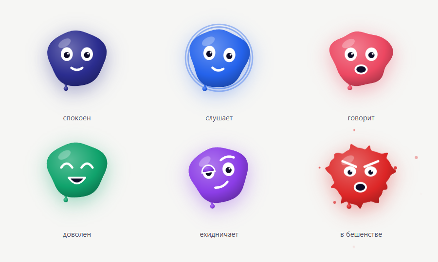
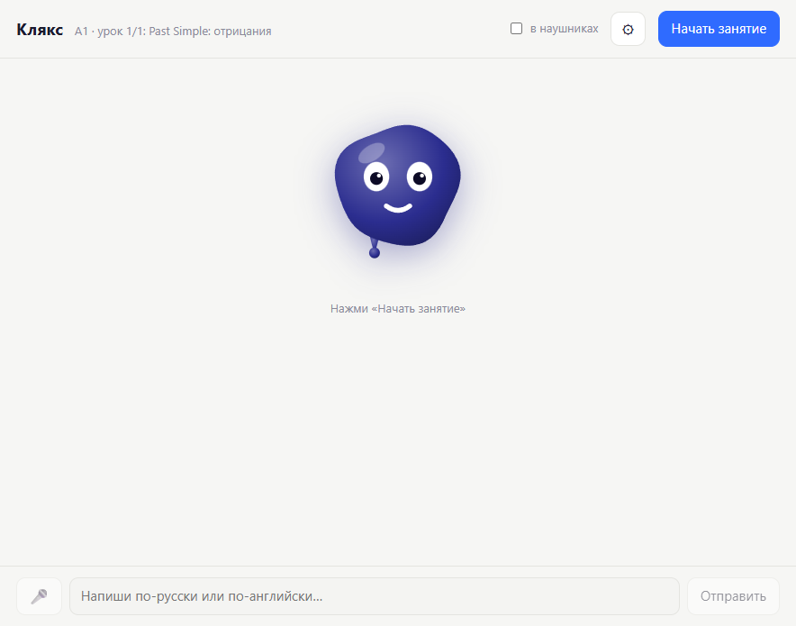

# Клякс — голосовой репетитор английского

Клякс — живая чернильная клякса, которая учит тебя английскому голосом. Говоришь с ним в микрофон (или пишешь), он отвечает голосом, исправляет произношение и грамматику, сам ведёт уроки и помнит, что вы проходили.



## Что умеет

- **Голос и текст.** Разговор вживую через Gemini Live, ответ примерно за секунду.
- **Тест уровня.** На первом занятии проверяет твой уровень и составляет личную программу уроков.
- **Память.** Помнит слова, ошибки, факты о тебе и на чём вы остановились.
- **Стиль общения на выбор:** жёсткий с матом, дерзкий без мата, дружелюбный или строгий учитель.
- **Характер.** Клякс радуется, ехидничает и бесится — и это видно по нему.



## Как установить (Windows)

1. Скачай `Klyaks-win64.zip` со страницы [Releases](../../releases/latest) и распакуй куда угодно.
2. Запусти `Klyaks.exe`. Если Windows покажет «Windows защитила ваш компьютер» — нажми «Подробнее» → «Выполнить в любом случае» (программа не подписана сертификатом).
3. Получи бесплатный ключ Gemini: [aistudio.google.com/apikey](https://aistudio.google.com/apikey) → **Create API key**.
4. Вставь ключ в окно настроек, выбери стиль и голос — и жми «Начать занятие».

Ключ и прогресс хранятся только у тебя на компьютере, в `%APPDATA%\Klyaks`.

**Важно:** Gemini доступен не во всех странах. Если программа пишет, что регион не поддерживается, — нужен VPN.

Галочку «в наушниках» ставь только в наушниках: тогда Клякса можно перебивать голосом.

## Запуск из исходников

Нужен [Node.js](https://nodejs.org) 20+.

```
npm install
npm start
```

Сборка `.exe`: `npm run dist` — готовая программа появится в `dist/Klyaks-win32-x64`.

## Как устроено

- `main.js` — окно, настройки, прогресс и лог
- `renderer/live.js` — клиент Gemini Live API с автопереподключением
- `renderer/audio.js` — микрофон 16 кГц и воспроизведение 24 кГц
- `renderer/face.js` — анимированная клякса
- `renderer/prompt.js` — стили общения, тест уровня, функции памяти
- `renderer/app.js` — интерфейс и логика занятия
